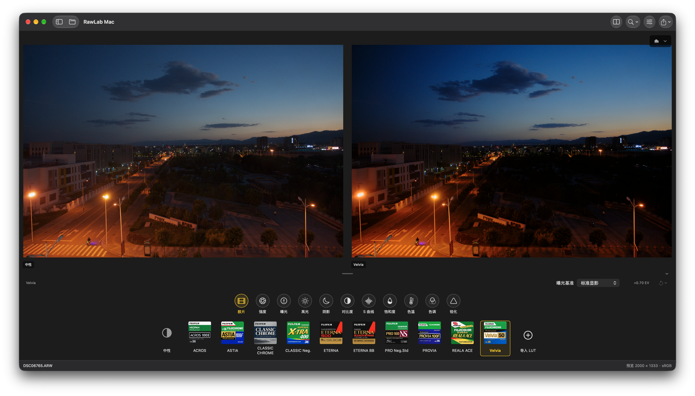

# RawLab ZSPro

**RawLab ZSPro** 是开源 [RawLab](https://github.com/dancancer/RawLab) 的 GPL-3.0 增强发行版，基线为上游 **v0.8.2（2026-10-20，build 14）**；更早 0.8.x 的功能已包含在该基线中。上游原始 README 附在下方。

## 与上游的差异 / Differences from upstream

### 一、原版更新内容（上游 v0.8.2，2026-10-20，build 14）

新增
- macOS、iOS、Android、Windows 四端直接导入受支持的 DCP 色彩配置，不再需要单独的转换工具。
- 新增 Nikon HE/HE* NEF、Sony ARW6 / Compressed RAW 2、Sigma X3F、JPEG 压缩 DNG 解码；相机识别新增 Sony A7 V / A1 II、Canon R50 V、PowerShot V1。

改进
- CPU look 处理与几何渲染更快；几何交互预览按视口尺寸渲染，最终导出保持全分辨率。
- iOS 普通图片预览初始化提速，单图 JPEG/DNG 导出复用已解码像素，减少重复解码与峰值内存。

修复
- Windows 同时带 ICC 与 EXIF 色彩元数据的合法 JPEG 显示正确颜色，缩放后的首预览颜色正确；白平衡取整与其它端一致。
- iOS 导入文件在异步导入、编辑、取消与冻结批量导出之间的生命周期。
- iOS 统计框架打包时的最低系统版本元数据。
- Android 批量进度、重启恢复与检查点失败处理，较大任务改用增量日志。
- 其余界面文案、翻译、错误信息与无障碍标签。

### 二、ZSPro 2.0 增加的内容

- **四面体 3D-LUT 插值**（CPU、GLES、D3D11、Metal 全渲染路径）：每像素 4 次采样而非 8 次，饱和区色相更稳定，LUT 格点上逐位一致。
- **松下 STD 底座适配**：按官方 STD→V-Log 映射把 "STD photo style" 的 look LUT 变换到中性基线，分层、保灰，减少插值带来的色噪。
- **Look 叠加烘焙**：两个 look 按各自强度合成为一个新的托管 look。
- **显示 look 契约与原生 FFI**：适配、烘焙与显示 look 统一走共享 C++ 核心；LUT 显示只影响整图渲染路径，不再影响降噪后端。
- **温度白平衡回退**：LibRaw 缺少相机色彩矩阵时回退 sRGB 矩阵，温度滑杆锚定 6500K；相机白平衡渲染不受影响。
- **Android 完整启用小波降噪**（vendored wavelib + OpenCV core/imgproc），并加入 GPU 降噪导出加速与导出耗时诊断测试。
- **Android 打包资源补齐**：内置 look、master recipes、胶片图标；编辑器标题显示 ZSPro。
- **质量门禁**：GPU/CPU 一致性测试（阈值 5e-5）、分带恢复逐位一致测试、导出耗时测试。

### 三、ZSPro 2.0 修复的内容

- **松下 CUBE「适配松下 STD 底座」报 `OverlappingFileLockException`**：文件锁不可重入，导入、适配与烘焙改为复用已持有的存储锁，并新增回归用例。
- **降噪功能打不开**：补链 OpenCV 各 ABI 的 3rdparty 静态库；降噪开关不再误绑 `ZSPRO_DNGSDK`，改为独立默认开启。
- **降噪导出明显变慢**：着色器内部像素改为基址递推，阶段间加 `glFinish` 分界，uniform 改用分槽更新；20MP 降噪导出 30.8s → 11.1s（约 2.8×），JPEG 字节数与优化前一致。
- **启用 LUT 时降噪被连带降级到 CPU**：降噪后端与整图管线解耦，Auto 仍在 GPU 真正失败后才回退。
- **非 GPU 构建中 display-look 路由编译失败**：`cpuOnlyStages` 改为可变。
- **Look 烘焙写入器的字符字面量损坏、FFI adapt/bake 实现缺失**：已恢复并加固 slim Android 构建。
- **slim 构建缺少镜头数据库时启动崩溃**：改为容忍缺失。
- **JPEG 校验误拒**：接受多图（MPF）JPEG 与 EOI 之后带尾随数据的文件。
- **清理上游 GitHub Actions 工作流**：ZSPro 不使用，且推送还需要 workflow 权限。
- **真机 look 测试的过期断言**：改为与库实际抛出的 `InvalidLookException` 一致。

### 验证

- GPU/CPU 一致性：`gpu_filter_tests` 全 PASS，最大误差 2.21e-6（照片效果 6.58e-5），阈值 5e-5；`wavelet_denoise_tests` 全 PASS，含分带恢复逐位一致。
- 真机导出（OnePlus 11 / Adreno 740）：20MP 降噪导出 11.8s（后端 GLES）；50MP 25.8s；50MP + 7.4MB CUBE 29.0s，峰值 PSS 约 2.79GB。
- 细节见 [gpu-denoise-performance-verification.md](RawLabAndroid/gpu-denoise-performance-verification.md)。

License: GPL-3.0 (see [LICENSE](LICENSE) and the in-app notices). ZSPro
source: https://github.com/ceasarboy/-RawLab-ZSPro

---

# RawLab (upstream)

[English](README.md) | [简体中文](docs/README.zh-CN.md)

Cross-brand RAW development and film looks, built around a shared C++ processing
core with native Windows, macOS, Android and iOS editors.

## Overview

RawLab develops camera RAW files, applies compatible Fujifilm film-simulation
LUTs and custom looks, and exports finished photographs without changing the
original files. It is an independent project, not an official Fujifilm product;
film looks do not promise an exact match to in-camera JPEGs.

## Features

- RAW development with exposure, camera-space white balance, tone, color and
  sharpening controls.
- Ordinary opaque RGB8 SDR images: JPEG/PNG
  on all four clients, TIFF on macOS/iOS/Windows and HEIF on macOS/iOS. Raster
  input shares the editing/export core without the RAW scene curve or camera
  controls. Unsupported HDR, high-bit-depth, transparent and multi-frame inputs
  are rejected rather than silently converted. See the
  [input contract](lutools/docs/color-contract.md#display-referred-raster-input).
- New RAW edits start with embedded-preview exposure matching. One-shot Auto
  exposure and an eight-channel HSL mixer are shared across all four clients;
  existing saved exposure baselines are preserved.
- Built-in film looks with 0-200% strength, compatible CUBE/RLOOK imports and
  neutral-versus-edited comparison.
- Fourteen master recipes with style artwork and matching controls across all
  clients. Applying a recipe replaces six adjustments and all 24 HSL values;
  0-200% strength scales the current recipe controls, HSL and LUT together.
  Saved edits and frozen batches preserve manual changes and per-target RAW WB.
- Drag-only mobile film/recipe lists and desktop overflow buttons, plus adaptive
  iPad portrait/landscape layouts. iOS adjustment ranges, steps and highlight
  direction match macOS without changing older saved rendering values.
- Linear-light wavelet denoising with separate luma, chroma and coarse-chroma
  controls, plus matching vignette and deterministic grain on all four clients.
  Metal, GLES 3.1 and D3D11 accelerate the shared denoising and effects kernels.
- Per-photo local edit memory and resumable batch export with frozen settings,
  cancellation and failed-item retry, without modifying RAW files.
- Photo information overlays, zoom/pan and original-size or long-edge exports.
  Desktop file browsers can reveal photos and apply confirmed current settings.
- JPEG and 16-bit PNG export on Windows, macOS and Android; JPEG export on iOS.
  Rendered DNG file export is available in single and batch workflows on all four
  clients. It bakes the current adjustments, not reversible sensor RAW controls.
  See the [rendered DNG contract and limits](lutools/docs/color-contract.md#rendered-dng).
  Readable capture metadata is retained, while output size and orientation are
  updated.
- Metal, Direct3D 11 and OpenGL ES processing where supported, with automatic CPU
  fallback. HSL runs in the platform photo GPU pipeline; RAW decoding and file
  encoding remain CPU operations.
- A shared C++17 core, command-line tools and a desktop LUT preparation utility.
- Desktop Agent JSON editing, capability discovery, previews and FINAL exports
  reuse the same parameters and processing core as the GUI and frozen batches.
- Crop, rotate, straighten, flip and perspective correction; photos open with
  one preview and optional before/after comparison.

## Platforms

| Client | Requirements |
| --- | --- |
| Windows | Windows 10/11, x64 |
| macOS | macOS 14 deployment target, Apple Silicon or Intel; physical minimum-OS coverage remains limited |
| Android | Android 8.0+, ARM64 or x86_64 |
| iOS | iOS 18+, iPhone and iPad; the downloadable IPA requires re-signing |

## Downloads and Documentation

- [Documentation index](docs/README.md)
- [Download the latest release](https://github.com/dancancer/RawLab/releases/latest)
- [v0.8.2 release notes (build 14)](docs/releases/v0.8/v0.8.2.md)
- [Installation and distribution notes](docs/guides/installation.md)
- [iPhone installation guide](docs/guides/ios-installation.md)
- [Changelog](CHANGELOG.md)
- [Product roadmap (Chinese)](docs/architecture/roadmap.md)
- [Windows client](RawLabWindows/README.md)
- [macOS client](RawLabMac/README.md)
- [Android client](RawLabAndroid/README.md)
- [iOS core build and integration](lutools/platform/ios/README.md)
- [Processing core and CLI](lutools/README.md)
- [LUT preparation](lutools/docs/lut-preparation.md)
- [RAW and color-processing contract](lutools/docs/color-contract.md)

## License

Copyright (c) 2026 RawLab contributors. This release's original project code is
distributed under the [GNU General Public License v3.0 only](LICENSE)
(`GPL-3.0-only`), with a narrow [Alibaba Cloud RUM SDK linking exception](LICENSE-ALIYUN-RUM-EXCEPTION)
under GPLv3 section 7. Third-party libraries, LUTs and other bundled assets retain
their own licenses and copyright notices. See [licensing and attribution](docs/reference/licensing.md).
